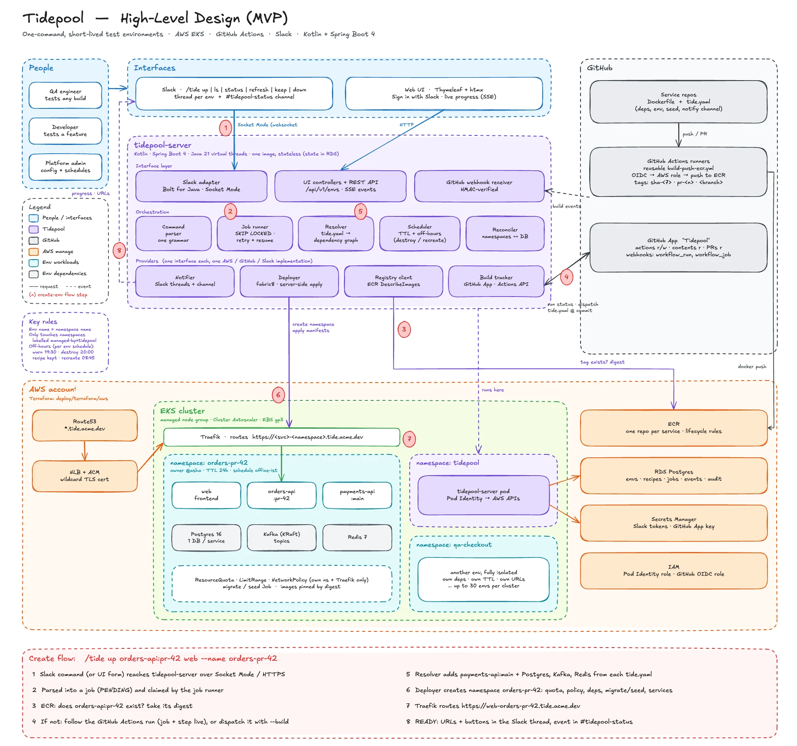

# Tidepool

**One-command, short-lived test environments on Kubernetes.**
Pick the services and image tags you want, and Tidepool works out what they need (Postgres, Kafka,
Redis, other services), spins up an isolated namespace, deploys everything and hands you the URLs in
Slack. When the day ends, it tears it all down.

> **Status: design phase.** No code yet. The full plan is in [docs/MVP.md](docs/MVP.md).

---

## Why

- **QA** waits for a shared staging slot, or tests a build that's already out of date.
- **Developers** can't easily test a feature against real dependencies before merging.
- **Long-lived test environments** cost money all night and all weekend while nobody uses them.

Tidepool gives every feature, PR or build its own environment in minutes, and makes sure nothing runs when nobody is working.

## Goals

### MVP goals
1. **Deploy services on demand:** `/tide up orders-api:pr-42 web` deploys the chosen services at the
   chosen tags, plus every dependency they declare, and reaches `READY` in under 5 minutes once images exist.
2. **Many isolated envs side by side:** one Kubernetes namespace per env, **referenced by its namespace
   name** everywhere (Slack, UI, URLs, `kubectl -n <ns>`), with quotas and network isolation.
3. **Build-aware:** if an image isn't in ECR yet, Tidepool follows the **GitHub Actions** run that is
   building it, shows live job and step progress, and deploys as soon as it finishes. It can start the build if needed.
4. **Web UI:** sign in with Slack; see, create, refresh, extend and delete envs; follow live progress; read logs; open URLs.
5. **Slack bot + channel notifications:** clear `/tide` commands, one live-updating thread per env, and
   every lifecycle event posted to `#tidepool-status`.
6. **No waste outside working hours:** envs are destroyed at night, on weekends and on holidays on a
   **configurable schedule**, with warnings, a "keep tonight" option and optional automatic rebuild before work starts.

### Design goals
- **Simple to run:** one Kotlin + Spring Boot service, one image, one Helm chart, one Terraform module.
- **Declarative:** each service describes its own needs in a small `tide.yaml` kept next to its code.
- **Safe by default:** Tidepool only touches namespaces it created, uses no static cloud keys, and envs can't reach each other.
- **Forkable:** integrations sit behind small interfaces, so a fork can add another cloud, CI system or chat tool without changing the core.

### Non-goals (for the MVP)
- Clouds other than AWS, CI systems other than GitHub Actions, chat tools other than Slack.
- Production deployments. Tidepool is for test and dev environments only.
- Keeping data overnight (comes later with snapshots and sleep mode).
- A standalone CLI (planned for v1.1. Slack and the UI cover everything in the MVP).

## Architecture

[](docs/architecture/tidepool-hld.png)

*Click the diagram for full size. The numbered red circles ① – ⑧ follow one `/tide up` request end to end, as explained in the strip at the bottom of the diagram.
To edit it, open [`docs/architecture/tidepool-hld.excalidraw`](docs/architecture/tidepool-hld.excalidraw) in [excalidraw.com](https://excalidraw.com) (Menu → Open), then export a new PNG over `tidepool-hld.png`.*

| Area | What lives there |
|---|---|
| **Interfaces** | Slack (`/tide` commands, a thread per env, `#tidepool-status`) and the web UI (Sign in with Slack, live progress) |
| **tidepool-server** | One Spring Boot app in three layers: interface (Slack, UI/API, GitHub webhooks), orchestration (parser, job runner, resolver, scheduler, reconciler), providers (notifier, deployer, ECR, GitHub) |
| **GitHub** | Service repos with `tide.yaml`, Actions runners that build and push to ECR, the Tidepool GitHub App that reports build progress |
| **AWS** | Route53 → NLB (TLS) → Traefik on EKS; one namespace per env with its services and Postgres, Kafka, Redis; ECR, RDS, Secrets Manager, IAM |

## How it works

1. You ask for services and tags in Slack or the UI.
2. Tidepool checks ECR for each image. If one is missing, it follows the GitHub build until it's ready.
3. It reads each service's `tide.yaml` and adds the required services, Postgres, Kafka and Redis.
4. It creates the namespace, deploys the dependencies, runs migrations and seed data, and starts the services in order.
5. It posts the URLs in your Slack thread and in `#tidepool-status`.
6. Outside working hours it destroys the env and keeps its recipe, so the env can be rebuilt the same way.

## Scope of the MVP

| Area | Choice |
|---|---|
| Cloud | AWS: EKS, ECR, Route53, ACM, NLB, RDS, Secrets Manager |
| Source + CI | GitHub + GitHub Actions (hosted or self-hosted runners) |
| Chat | Slack (Socket Mode) |
| Language | Kotlin, Spring Boot 4, Java 21 |
| Kubernetes access | fabric8 kubernetes-client |
| UI | Thymeleaf + htmx, served by the same app |
| Infra as code | Terraform |

## Repositories

| Repo | Purpose |
|---|---|
| **tidepool** (this repo) | Server, UI, Helm chart, Terraform, reusable GitHub build workflow, docs |
| [tidepool-examples](https://github.com/viren97/tidepool-examples) | Three demo services (`web`, `orders-api`, `payments-api`) that show `tide.yaml` and the build workflow in action |

### Planned layout
```
tidepool/
  core/          domain model, tide.yaml parsing + validation, command grammar, naming rules
  server/        Spring Boot app: ui, api, jobs, resolver, deployer, integrations/{aws,github,slack}
  deploy/
    helm/tidepool/       installs Tidepool on EKS
    terraform/aws/       EKS, ECR, DNS, cert, RDS, IAM
  .github/workflows/build-push-ecr.yml   reusable workflow for service repos
  docs/
```

## Roadmap

| Stage | Focus |
|---|---|
| **M0–M5 (MVP, ~3 weeks)** | AWS foundation → deploy engine → server + GitHub build tracking + off-hours schedule → web UI → Slack → hardening |
| **v1.1** | DB snapshots (with anonymisation), `tide` CLI, roles, audit log |
| **v1.2** | PR environments driven by GitHub labels, PR comments and Deployments |
| **v1.3** | Sleep mode (keep data overnight), scale-to-zero when idle, shared baseline, cost per env |
| **v2** | Optional managed AWS deps, public API, provider guide for other clouds, CI systems and chat tools |

Details for each stage are in [docs/MVP.md](docs/MVP.md).

## Docs
- [docs/MVP.md](docs/MVP.md): MVP definition of done, architecture, namespaces, off-hours schedule,
  GitHub integration, `tide.yaml`, setup guide, Slack commands, tech stack, milestones, improvement plan.

## License
[Apache License 2.0](LICENSE). Fork it, change it, ship it.
